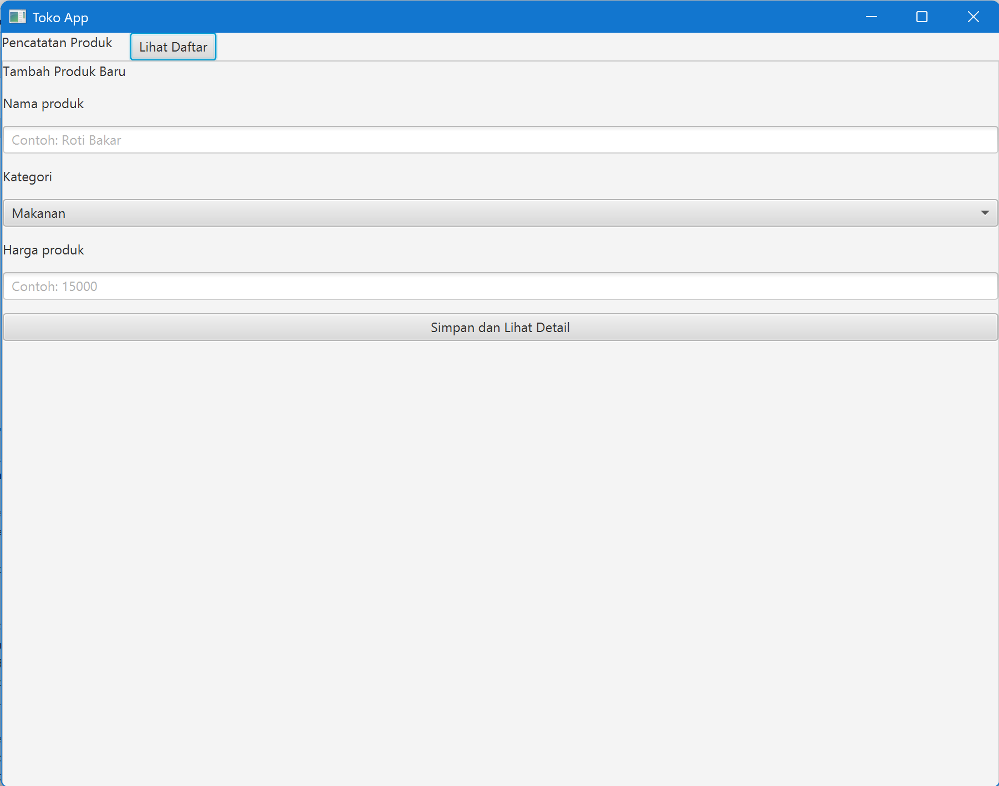
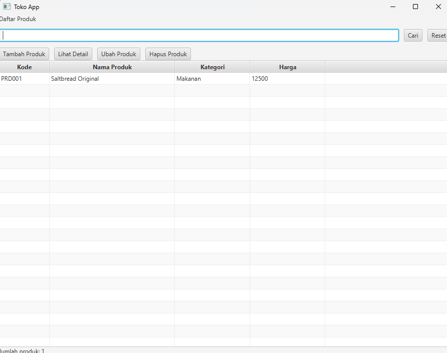

# TokoApp - JavaFX

Aplikasi desktop manajemen toko (TokoApp) yang dibangun menggunakan Java, Maven, dan JavaFX (SceneBuilder).

## 📸 Screenshot Aplikasi
<!-- Silakan ganti nama file gambar di bawah ini dengan screenshot aplikasi Anda yang sebenarnya -->



## 💻 Persyaratan Sistem
- Java Development Kit (JDK) 21
- Apache Maven
- Apache NetBeans (untuk mode pengembangan)

## 🚀 Cara Menjalankan Aplikasi

**Melalui Terminal / Command Prompt:**
1. Buka terminal dan arahkan direktori ke folder project ini.
2. Jalankan perintah berikut:
   ```bash
   mvn clean javafx:run

## ❔ Cara Menggunakan Aplikasi
1. Masukan nama produk Anda
2. Pilih katergori produk
3. Isi harga produk
4. Klik Simpan dan Lihat Detail, akan muncul scene berisi informasi produk

## 📃 Cara Melihat Daftar
1. Klik pada tombol Lihat Daftar

## ♻️ Cara Mengubah Produk
1. Pilih produk yang ingin diubah pada scene Daftar Produk
2. Klik tombol Ubah Produk
3. Ubah produk sesuai keinginan
4. Lalu, klik Simpan Perubahan untuk menyimpan perubahan

## 🗑️ Cara Menghapus Produk
1. Pilih produk yang ingin dihapus pada scene Daftar Produk
2. Klik Hapus Produk, akan muncul konfirmasi jika ingin menghapus produk
3. Klik Yes
4. Produk berhasil terhapus
