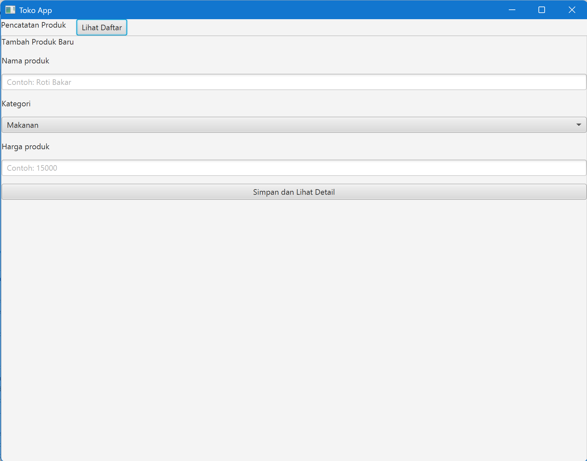

# TokoApp - JavaFX

Aplikasi desktop manajemen toko (TokoApp) yang dibangun menggunakan Java, Maven, dan JavaFX (SceneBuilder).

## 📸 Screenshot Aplikasi
<!-- Silakan ganti nama file gambar di bawah ini dengan screenshot aplikasi Anda yang sebenarnya -->


## 💻 Persyaratan Sistem
- Java Development Kit (JDK) 21
- Apache Maven
- Apache NetBeans (untuk mode pengembangan)

## 🚀 Cara Menjalankan Aplikasi

**Melalui Terminal / Command Prompt:**
1. Buka terminal dan arahkan direktori ke folder project ini.
2. Jalankan perintah berikut:
   ```bash
   mvn clean javafx:run
